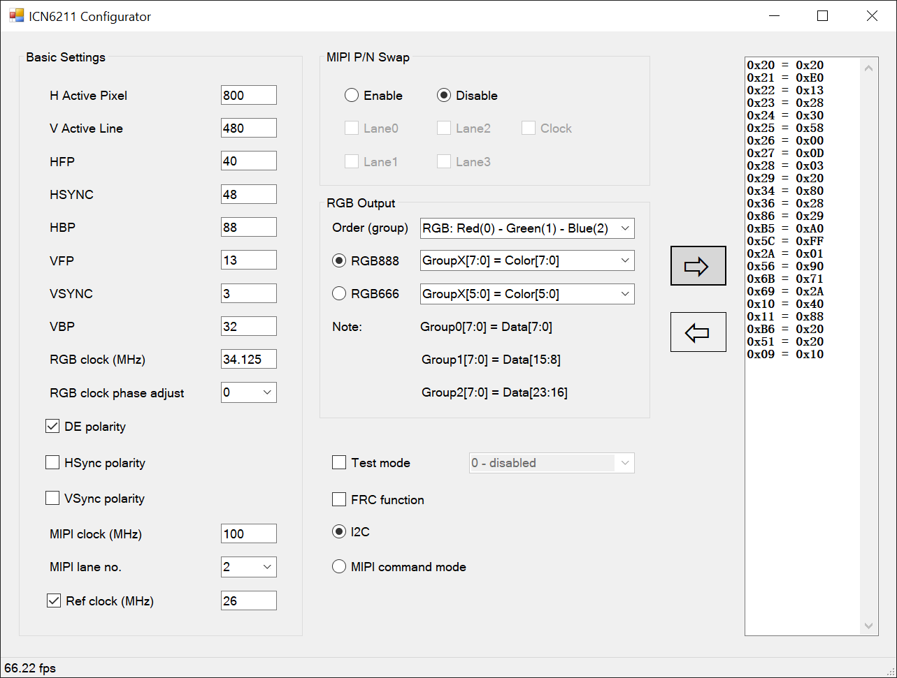

# ICN6211 Configurator
This repository contains a popular ICN6211 MIPI-DSI to DPI bridge configurator written in C#. The configurator was developed based on information gathered from numerous forum discussions and blog posts, primarily those related to the Linux kernel and device drivers, as the detailed ICN6211 specification is not publicly available.

Contributions are welcome. Please feel free to share your comments, report issues, or suggest improvements.

